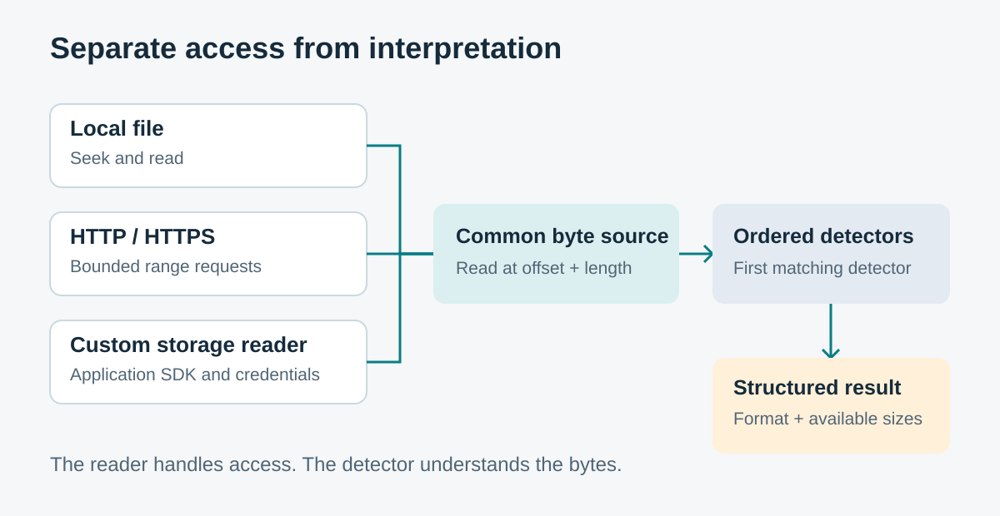
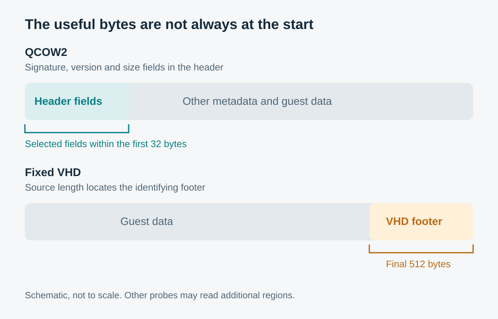

Before a cloud platform imports an image, or a migration tool converts one, there are a few fairly ordinary questions to answer. What format is it? How large is the virtual disk? What is the file’s logical size?

The awkward part is that the image may be sitting in object storage, behind a temporary download link, or in a storage service with its own way of reading data. Downloading several gigabytes just to answer a handful of questions feels like rather a lot of work before the real work starts.

That is the problem behind [VDiskProbe](https://github.com/ArvinZJC/VDiskProbe), my Python library for recognising virtual disk image formats and reading available size metadata. I wanted something small enough to embed in a service, with no third-party runtime dependencies, and a way to inspect remote images through the storage access the application already has.



## Why I wanted a library

`qemu-img info` is an obvious starting point. QEMU already understands a wide range of image formats and storage protocols. It can return structured output with `--output=json`, so a service does not have to parse its human-readable display.

My difficulty was the surrounding integration. Using it from a small Python service still means supplying the external executable and its runtime environment. A storage backend may already have a working Python client, complete with authentication and application-specific behaviour, without having an equivalent path through QEMU. Adding that integration can involve more coordination than the inspection itself warrants.

The scope I had in mind was small: enough information to accept an image for further checking, choose a conversion path or flag an unrecognised format. I wanted that initial inspection available as a library call, leaving conversion and access to the guest’s contents to other tools.

## A 512-byte clue

One example made the distinction between recognising a format and opening a known format particularly clear. I ran `qemu-img info` against a Rocky Linux Azure VHD over HTTPS. Automatic detection reported `raw`. Supplying `-f vpc` told QEMU to open it as VHD, which succeeded; QEMU uses `vpc` as the format name.

These were the relevant values from that run:

| Invocation | Reported format | Reported virtual size |
| --- | --- | ---: |
| Automatic detection | `raw` | 10,737,418,752 bytes |
| Explicit `-f vpc` | `vpc` | 10,737,418,240 bytes |

Both values appeared as 10 GiB in the rounded display. The byte counts differed by exactly 512.

A fixed VHD has its identifying footer at the end of the file. Unlike its initial signature probe, QEMU's [fixed-VHD opening path](https://github.com/qemu/qemu/blob/1bd7bfbc2ba3ed767eaff3bd73f598e877b30f28/block/vpc.c#L289-L310) can seek to that trailing footer. The result above is consistent with that layout: treating the file as raw includes the footer in the apparent guest capacity.

Explicitly selecting the format worked in this run. The example illustrates a limit of automatic probing rather than a general problem with HTTPS or QEMU’s VHD support. It left me with a useful design question: if the evidence is at the end, can the detector ask for those bytes directly?

## Ask for bytes, then interpret them

VDiskProbe separates two responsibilities. A reader knows how to obtain bytes from a source. A detector knows where to look and how to interpret what it finds.

The basic request is simple: read a bounded number of bytes at a given offset. A local file can satisfy that through seeking. An HTTP or HTTPS source can use byte-range requests. An application can wrap its existing storage client in a custom reader. The detector works with the returned bytes regardless of how they were fetched.

*The same format detectors can work with different storage readers.*

Internally, `ByteSource` adapts the reader, an ordered registry tries detectors, and the first match produces an `ImageInfo` object. Repeated reads and reads within a cached prefix can reuse bytes already fetched.

The library has built-in local-file and HTTP support; other backends need an adapter that provides random access. Source length is also needed for reads relative to the end. Authentication and SDK integration for those custom backends remain the application’s responsibility.

## Why a small amount of data can be enough

Image formats often place identifying information and capacity fields in defined locations. Recognising those structures does not require reading all the guest data they describe.

QCOW2 is a compact example. Its [header specification](https://www.qemu.org/docs/master/interop/qcow2.html#header) places the signature and version at the start, the cluster-size exponent at bytes 20–23, and the virtual capacity at bytes 24–31. These are zero-based byte offsets. The capacity is stored as an integer, so there is no need to calculate it by counting the image's data blocks. A cluster exponent of 16 means a cluster size of 2¹⁶ bytes, or 64 KiB.

A fixed VHD illustrates the other end of the file. Once the source length is known, the detector can request the final 512 bytes and inspect the footer. Other formats require following metadata pointers or reading a bounded descriptor. There is no universal “read the first few bytes” shortcut.

*Locations are schematic, not to scale. These are the useful regions for the examples, not a complete trace of every detector or transport request.*

The practical saving comes from transferring selected metadata instead of the whole object. It is not a promise of one request, a fixed total byte count or constant response time. A detector may need several reads, and a remote endpoint still introduces latency, retries and size-discovery requests.

For HTTP, the server also has to cooperate. VDiskProbe checks range responses and does not download the full image to imitate random access. A server that ignores ranges may still allow a signature at offset zero to be recognised, but reading a footer is a different matter. If a refused range prevents detection and no other signature matches, the library raises an error rather than silently calling the image raw.

## Four different meanings of size

“Image size” turns out to be an unhelpfully broad phrase. I kept the quantities separate in the result:

| Field | What it describes |
| --- | --- |
| `file_size` | The logical length of the source: where its end is. |
| `disk_size` | Host filesystem allocation, when available. |
| `virtual_size` | Guest-visible capacity from format metadata, or source length for the raw fallback. |
| `cluster_size` | The format's allocation unit or block size, where applicable and available. |

A sparse file can have a large logical length while occupying fewer blocks on its host filesystem. A dynamically allocated image can advertise a large guest disk while storing much less data. Its cluster size is another quantity again.

For HTTP, the total in `Content-Range` can establish source length, as can `Content-Length` on a response describing the whole object. The `Content-Length` of a partial response describes only that response body. Neither header reveals allocation on the remote server.

Unavailable values are normally `None` in Python and `null` in JSON. There is one fallback worth remembering: for local files on platforms without filesystem block counts, `disk_size` uses logical file size. It is therefore not always a measurement of allocated storage.

## What the checks establish

The project’s tests separate byte interpretation from storage access. Synthetic headers supply known signatures and capacity fields. Recording readers track requested offsets and lengths, so read behaviour can be checked without multi-gigabyte fixtures. HTTP tests use simulated responses and a local server to cover range handling and failures.

Together, these checks support the feasibility of inspecting selected regions under controlled conditions. They are not a benchmark of remote performance or evidence of compatibility with every image producer and storage service.

## Recognition has limits

A signature match is evidence of a format, not proof that the entire image is complete, internally consistent or bootable. VDiskProbe can recognise a short header even when optional metadata is missing. Its confidence values describe the matching rule; they are not statistically calibrated probabilities of a healthy image.

Raw needs particular care because it has no single identifying signature. In VDiskProbe it is the low-confidence fallback when no recognised signature matches. That can mean a raw image, an unsupported format or insufficient identifying data. Its reported virtual size is the source length, assuming the image really is raw; it is not independently verified guest capacity. I would treat that result as a reason for further checks before import.

The inspection also assumes the source remains stable between reads. If it changes halfway through, individually successful requests can return metadata from different versions of the image. Consistency guarantees still belong to the surrounding application.

## Enough information for the next step

For me, the useful outcome is a first look that reads only selected regions: recognise what can be recognised, return the metadata that is actually available, and let the caller decide whether deeper inspection is needed.

That fits image-import preflight checks, migration tooling, download-link checks and operational automation. It does not replace conversion, full integrity checks, decryption or opening the disk as a block device.

The repository contains the code and usage examples. The decision I wanted to record here is simple: when the question only needs a few pieces of metadata, make it possible to ask for those pieces without first moving the entire disk.
